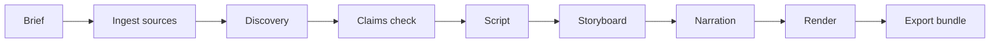

# Training Video Builder


An agentic pipeline that turns a short brief into a finished, narrated training video. It drafts every artefact with an LLM, puts a human approval gate between stages, and renders the final cut in Rust. A 4 minute 54 second video renders in about 15 seconds.

The proof is video 1: "Copilot Prompting for Beginners", an 8-scene, 1080p training video built end to end by this repo, then given an ElevenLabs voice over the top with ffmpeg.

## How it works



Each stage writes an artefact into `projects/<id>/` and nothing advances until you approve the stage before it:

```
uv run poc-remotion status  --id copilot-prompting-basics
uv run poc-remotion approve --id copilot-prompting-basics --stage storyboard
```

Model calls route through a LiteLLM gateway with per-project virtual keys and budgets. Narration defaults to Kokoro ONNX running locally, so a video costs tokens only where a model is genuinely needed.

## What we learned about Remotion

The first version rendered with [Remotion](https://www.remotion.dev): one React component per scene, output through headless Chromium. It worked, and it shipped the approved video 1. We replaced it anyway, and the comparison is the most useful thing in this repo.

A side-by-side port of all 8 scenes to fframes, a Rust crate that draws SVG scenes through Skia and encodes with ffmpeg, produced a frame-accurate match of the approved cut. The same frames took about 9 seconds to render against several minutes through the Remotion pipeline.

What made the difference:

- **The browser was most of the weight.** These scenes are deterministic vector layouts: text, rounded rectangles, a character built from two circles and four lines. React, hooks and a DOM renderer added nothing that plain SVG in Rust could not express, but Node and a browser binary were still required to run it.
- **Compile-time media beat runtime plumbing.** fframes embeds the storyboard, narration and fonts at compile time, so a render is an incremental `cargo build` with no asset resolution to get wrong on the day.
- **Porting exposed real defects.** Redrawing each scene from scratch surfaced bugs the approved video carried: a character invisible against dark backgrounds, and news cards that hugged their text instead of filling a uniform grid. One explicit drawing path per scene leaves less room for drift between design and output.
- **Licensing scales differently.** Remotion is free for individuals and teams of up to three people; larger companies need a paid licence. Worth knowing before a proof of concept becomes a product.

The decision record lives at `docs/superpowers/specs/2026-10-23-fframes-renderer-swap.md`. Remotion is gone from the repo entirely; the renderer is the Rust crate in `renderer/`.

## Narration: local first, ElevenLabs for the overlay

Kokoro ONNX narrates by default. It runs on the machine, costs nothing per video, and its audio length sets each scene's duration.

For a different voice we had ElevenLabs generate a full-script read with a cloned voice and overlaid it on the finished render with ffmpeg, copying the video stream untouched:

```bash
ffmpeg -i video.mp4 -i alex.mp3 \
  -map 0:v:0 -map 1:a:0 -c:v copy -c:a aac -b:a 192k -shortest \
  video-alex-voice.mp4
```

The ElevenLabs read came out within 70 ms of the Kokoro-paced runtime, so the single track dropped onto the existing scene timings without re-cutting anything. The result is `projects/copilot-prompting-basics/output/video-alex-voice.mp4`. For pipelines that should use ElevenLabs throughout, the clean route is per-scene TTS behind the existing narrate stage, so scene durations derive from the real audio; that needs an API key and a budget approval.

## Cost

About **$12** of LLM tokens built everything in this repo: briefs, discovery, scripts, storyboards, claims checks and revisions, all GLM 5.3 Flash through LiteLLM. Narration and rendering run locally, so beyond tokens each video costs nothing to produce.

## Getting started

Prerequisites: Python 3.13 with uv, a Rust toolchain, ffmpeg, and two gitignored locals: the brand fonts in `src/fonts/` and the Kokoro models at the repo root. A fresh clone needs both before it can render.

```bash
uv sync
uv run pytest            # 149 tests
uv run ruff check .
```

Building a video walks the stages in the diagram above. Every stage is a subcommand with `--help`, and `status` shows which approvals a project is waiting on. To see a finished one:

```bash
uv run poc-remotion render --id copilot-prompting-basics
uv run poc-remotion export --id copilot-prompting-basics
```

Exports land in `projects/<id>/output/bundle/` with the video, SRT subtitles, storyboard, script, claims and provenance.

## Repository layout

- `src/poc_remotion/`: the pipeline: drafting, gating, TTS, the render bridge and export
- `renderer/`: the fframes Rust crate; project data is staged into it per render and cleaned after
- `projects/`: one directory per video, gitignored because it holds generated media
- `docs/`: the PRD, the design spec and decision records
- `tests/`: 149 pytest tests, including the gated render bridge
- `AGENTS.md`: how coding agents are meant to work in this repo

## Notes

- The brand font (PP Pangram Sans) has an unconfirmed licence and stays out of Git.
- Videos, narration audio and model files are gitignored; nothing generated is committed.
- Workstation setup (OpenCode, 1Password, LiteLLM keys) follows the lab instructions referenced in `AGENTS.md`.
